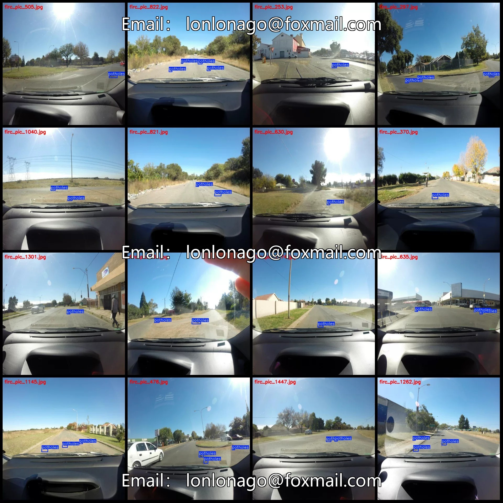
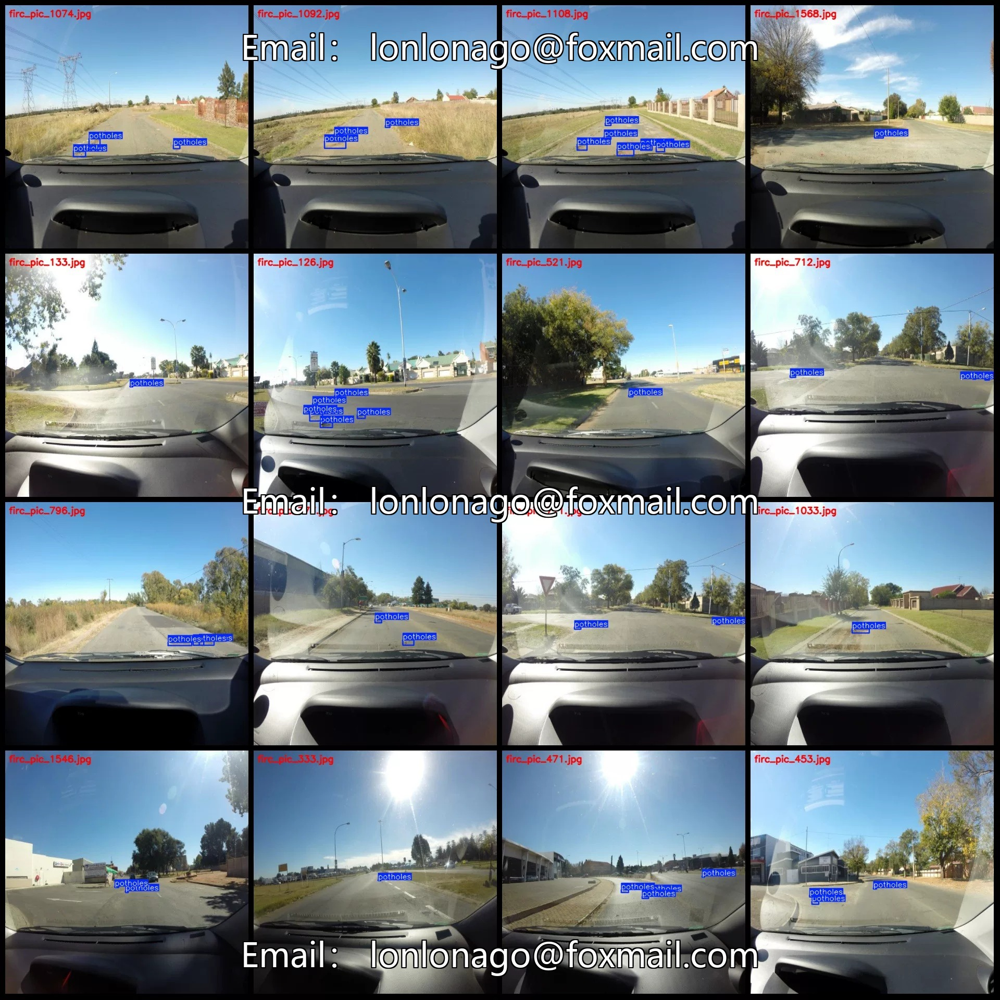
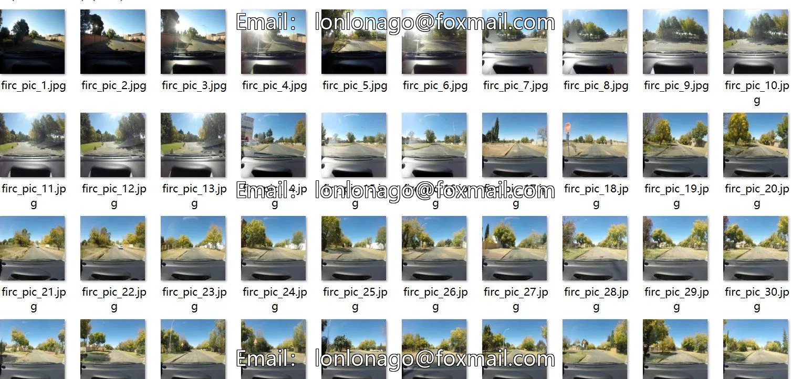
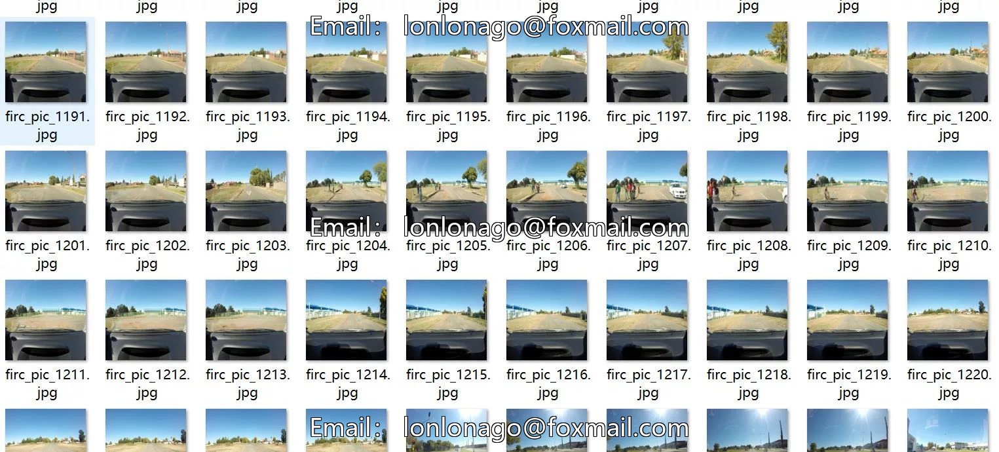

# Vehicle monitoring perspective road bump detection dataset VOC+YOLO format 157

## Body

Vehicle Monitoring Perspective Road Potholes and Cracks Detection Dataset VOC+YOLO Format - 1576 Images in 1 Category

Warm Reminder: Due to the dataset's replicability, please confirm compliance with requirements before purchasing.

Dataset Format: Pascal VOC format + YOLO format (excluding split paths in txt files, only containing jpg images along with corresponding VOC format xml files and yolo format txt files)
Number of Images (JPG Files): 1576
Number of Annotations (XML Files): 1576
Number of Annotations (TXT Files): 1576
Number of Annotation Categories: 1
Annotation Category Name: ["potholes"]

Potholes Frame Count = 3567
Total Frame Count: 3567
Number of Images per Category
Potholes Image Count = 1576
Image Resolution: 640x640
Labeling Tool: labelImg
Labeling Rules: Draw a rectangle around the category.
Important Note: The dataset does not have separate training, validation, and test sets; you need to partition them yourself.
Special Remark: This dataset does not guarantee the accuracy of the trained models or weight files.

## Images

## Payment

Here is a pay link on Stripe ( https://buy.stripe.com/3cs8yP7sY87d0vu9AB ). Please contact me lonlonago@foxmail.com after funding $89, and I will send you a complete data files , thank you!

